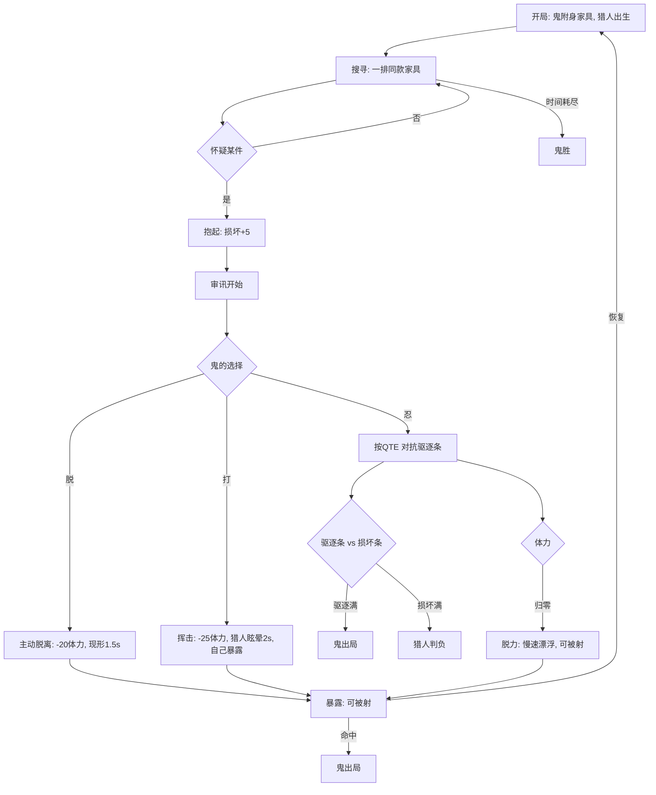

# 《Prop Hunt / 会杀人的家具》白盒 Demo — 设计文档 v1.0

> 版本：v1.0（2026-10-29，最终评审版）
> 取代：v0.5 及之前的所有版本
> 状态：设计定稿（待实机验证），工程现状 + TODO 同步
> 本文是白盒阶段的**唯一权威文档**。协作者先读 §2、§3、§4；追踪进度看 §8。

---

## 0. 文档约定

| 状态 | 含义 |
|---|---|
| `TODO` | 未开始 |
| `DOING` | 进行中 |
| `DONE` | 已实现且自测通过 |
| `BLOCKED` | 被外部条件卡住（写明卡点） |
| `CUT` | 本期明确不做 |

**三条纪律**

1. 白盒只验证**一个体验**，不验证美术、商业化、留存。
2. 任何新系统，如果不能用一句话说清"它让审判更紧张在哪"，就不做。
3. 改规则必须同步改 §6 参数表，否则下次没人知道数值从哪来。

---

## 1. 最终评审

### 1.1 我们卖的是什么

> **把"确认这件家具里有没有鬼"这个瞬间，做成一场双方都要操作的对抗。**

不是"变成家具"，不是"家具会杀人"，也不是"QTE"。
这三件事都是**已经被验证过的零件**，它们存在的唯一理由，是把这个瞬间撑起来。

### 1.2 竞品结论：零件全是红海，交叉是空白

| 零件 | 谁做过 | 结论 |
|---|---|---|
| 变身/附身家具 | Roblox（单款上亿访问）、GMod、MGH、Meccha、itch 一堆 | 红海，玩家零学习成本 |
| 道具反击 | Possessions、Ghost HQ、Mimic Busters、Roblox 的 *Hide or OOF!* | 常见设计 |
| 拿起道具确认 | GMod（二元判定：拿得起来就是空的） | 有，但瞬时 |
| 被抓后按键挣扎 | 黎明杀机、德州电锯、第五人格 | 成熟机制，但只用在"人被抓" |
| **四者交叉：抱起 + 摇晃 + 鬼在里面硬撑** | **无** | **空白** |

**红海恰恰是好事**：四个零件都有人做过，意味着玩家不需要被教育；而交叉没人做，意味着新鲜感来自"组合"而不是"解释"。

### 1.3 五个风险（这是评审的重点）

**R1｜它可能退化成一个按键小游戏。**
如果 QTE 占了 80% 的注意力，玩家的体验就是"看着屏幕按空格"，而不是"我在演一把椅子"。这是最可能失败的方式。
→ 对策：QTE 要短、要粗；决策（忍/脱/打）要比手速重要。

**R2｜NvM 会稀释紧张感。**
一个人被抱着摇 15 秒，另外三个人在干什么？如果答案是"等着"，那这个机制在多人里就是负资产。
→ 对策：审讯必须可被打断/可被围观/可被队友利用；单次时长控制在 5–15 秒。

**R3｜反杀可能变成最优解。**
如果"抽一下猎人"比"藏好"收益高，所有人都会变成会走的椅子，躲藏玩法直接消失。
→ 对策：挥击消耗体力（25）+ 暴露 1.5 秒 + 8 秒冷却，让它成为**高风险选项**。

**R4｜猎人可能不敢碰家具。**
损坏条满了猎人判负，如果惩罚太重，理性玩家会"只搜不碰"，核心机制永远触发不了。
→ 对策：首版损坏阈值给宽，用遥测看"每局抱起次数"。

**R5｜晕动症。**
镜头被甩是卖点也是门槛。
→ 对策：白盒就留"降低摆动/关闭翻滚"的开关，别等测试出问题再补。

### 1.4 证伪标准（什么情况下这个方向该放弃）

白盒跑 6 局（≥4 人），如果出现下面任意两条，就要重新考虑核心：

| 编号 | 证伪信号 | 判定 |
|---|---|---|
| F1 | 审讯过程中，玩家**没有**出现说话、笑、倒吸气等反应 | 社交体验不成立 |
| F2 | 两局之后，猎人**不再主动抱起**家具 | 成本设计失败 |
| F3 | 鬼的胜利方式**主要靠"不被找到"**，而不是靠"撑住/反杀" | 审判环节无关紧要 |
| F4 | 鬼的行动里 **>70% 是挥击** | 躲藏玩法已死 |
| F5 | 单次审讯平均 **<3 秒** | 没有张力，只是点击 |
| F6 | 玩家描述体验时只说"按得准/按不准" | 退化成了音游 |

**F2 和 F6 是最危险的两条。**

### 1.5 这个白盒值得做吗

值得，理由只有一条：

> 它是这个品类里**唯一还没被做过、且成本极低就能验证**的交叉点。

成本低体现在：附身、拾取、镜头、QTE、联机、大厅都已经能跑（§7），缺的是**规则和手感**，不是从零搭框架。

---

## 2. 设计法则

这五条用来裁决所有争议，优先级高于任何具体数值。

1. **审判必须是两个人的事。** 任何一方挂机（猎人不碰、鬼不动）都不该是最优解。
2. **猎人必须先付出，才拿到信息。** 抱起=承担风险；没有免费的确认。
3. **鬼的每一次"反"都要花掉整局资源。** 体力是唯一货币，不能白嫖。
4. **信息只能通过"行为"泄露，不能通过 UI 泄露。** 敌人身上不能有"我是鬼"的标记。
5. **一局必须有硬截止。** 没有计时，博弈不收敛。

---

## 3. 核心机制：审判对抗

### 3.1 定义

> 猎人怀疑某件家具 → 抱起来 → 家具开始"表演" → 双方在 5–15 秒内互相试探 → 有人先撑不住。

三个参与者：

- **猎人**：付出损坏风险，换取信息；
- **鬼**：付出体力，换取"被当成普通家具"；
- **家具**：承载一切的中介——它的损坏值同时是猎人的成本、鬼的掩体。

### 3.2 一局的时序



### 3.3 三条命门（鬼）

| 命门 | 怎么触发 | 后果 |
|---|---|---|
| **驱逐条** | 被抱着摇，且 QTE 顶不住 | 直接出局 |
| **体力** | 挥击 / 主动脱离 | 归零后脱力：不能附身、25% 移速、可被武器命中 |
| **暴露** | 主动脱离 / 被驱逐 / 脱力 | 1.5 秒窗口内被武器命中即出局 |

三条命门的设计意图：**鬼不是"被抓就死"，而是"每次挣扎都在消耗未来"。**

### 3.4 两条条赛跑（猎人的两难）

```
摇晃 → 驱逐条 ↑ ──满──> 鬼出局（猎人赢）
摇晃 → 损坏条 ↑ ──满──> 猎人判负
```

- 鬼按对 QTE → 驱逐条变慢，但猎人不会停手，损坏条继续涨；
- 猎人越急，越可能先摇坏椅子；
- 鬼越能忍，越能把猎人逼到"再摇就赔"。

**这是整个玩法的心脏**：它让"放下"成为一个理性的、被逼出来的选择，而不是玩家的善意。

### 3.5 每条规则解决什么问题

| 规则 | 解决的问题 |
|---|---|
| 抱起有损坏成本 | 猎人不能无脑逐个验货（法则 2） |
| 鬼按 QTE 能拖 | 被抱住不等于结束，保留操作空间 |
| 驱逐满=出局 | 输出明确的失败态，避免无限僵持 |
| 体力 | 让"反"有代价，防止全员变刺客（R3） |
| 脱力可被射 | 给猎人一个"稳赢"的收尾手段 |
| 主动脱离有暴露 | 给鬼一条逃生路，但不清空风险 |
| 回合计时 | 防止躲到天荒地老（法则 5） |

---

## 4. 支撑系统：它们只为一件事服务

每一个系统都必须回答："它让审判更紧张在哪？"

| 系统 | 对审判的贡献 | 删掉会怎样 |
|---|---|---|
| **附身** | 定义"伪装"这一端 | 没有前提 |
| **同款家具 ×8** | 制造"不确定" | 一眼看穿，审判不成立 |
| **反杀** | 给"忍"一个替代选项，制造双向风险 | 鬼只能忍，没有博弈 |
| **木头人（注视时移动有提示）** | 让"装"变成持续操作 | 藏好就完事，过程无张力 |
| **体力/脱力** | 把单次审判连成一局 | 每次都是独立小游戏 |
| **损坏值** | 给猎人成本，逼出"放下" | 猎人永远摇到底 |
| **回合计时** | 逼猎人冒险，逼鬼现身 | 双方都可以拖 |
| **罗盘（可选开关）** | 控制"搜寻"难度，用于对照实验 | 见 §4.5 |
| **武器** | 收割暴露的鬼 | 暴露不构成威胁 |

### 4.5 罗盘为什么做成开关

它是**唯一一个会破坏"信息不对称"的系统**。保留它，搜寻变简单；关掉它，审判频率变低。
白盒阶段两种各测三局，用 F1/F3 两个指标判断哪种更接近目标体验。**默认关闭。**

---

## 5. 白盒范围

### 5.1 必须做（缺一个就无法验证）

- 8 把外观完全相同的可附身家具；
- 无任何"这是鬼"的视觉标记；
- 抱起 / 摇晃 / 放下；
- 驱逐条 + 损坏条同时可见；
- 体力与脱力状态；
- 挥击（消耗体力）；
- 猎人武器（仅命中未附身）；
- 120 秒回合计时与两种胜负；
- 服务端权威判定。

### 5.2 可以后置

- NvM 人数上限（先 1v1 验机制，再放到 2v2/3v2）；
- 木头人提示（先用最简单的晃动/声音占位）；
- 罗盘、语音、皮肤、动画、音效资产；
- 观战、匹配、成就。

### 5.3 明确不做

- 美术风格化、正式动画、正式音效；
- 商店页、宣传片；
- 移动端适配；
- 任何"以后可能用到"的架构重构。

---

## 6. 规则参数表（v1.0 初值）

| 参数 | 初值 | 备注 |
|---|---|---|
| 回合时长 | 120s | 超时鬼胜 |
| 同款家具数量 | 8 | 太少无不确定，太多搜不完 |
| 附身距离 | 250cm | 现有实现 |
| 抱起距离 | 300cm | 现有实现 |
| 驱逐条基础速率 | 0.15/s | ≈6.7s 满 |
| 摇晃加成 | 0.002 × 角速度(°/s) | 待调 |
| QTE 命中 | 冻结 1s，进度 −0.05 | 现有实现 |
| QTE 失误 | 进度 +0.1 | 现有实现 |
| 损坏上限 | 100 | 满则猎人判负 |
| 抱起损坏 | +5 | |
| 摇晃损坏 | +2/s | |
| 摔落损坏 | +15 | |
| 挥击损坏 | +20 | |
| 体力上限 | 100 | |
| 附身恢复 | +2/s | |
| 漂浮恢复 | +6/s | |
| 挥击消耗 | 25 | |
| 主动脱离消耗 | 20 | |
| 再附身阈值 | 30 | |
| 脱力移速 | 25% | |
| 挥击眩晕 | 2s | |
| 挥击冷却 | 8s | |
| 暴露窗口 | 1.5s | |
| 武器射程 | 250cm | 近战占位 |
| 武器冷却 | 1.5s | |

### 6.1 待确认（影响手感，不阻塞开工）

| ID | 问题 | 建议 |
|---|---|---|
| Q1 | 被抱起时能否主动脱离？ | 允许，但需要 1.5s 挣脱读条，期间驱逐条照涨 |
| Q2 | 附身时家具能否微移？ | 先关，靠"木头人提示"表达"动了一下" |
| Q3 | 武器一击捕获还是多段？ | 一击；脱力已经足够脆弱 |
| Q4 | 挥击命中后其他猎人能否补枪？ | 能，制造"被围"的紧张 |
| Q5 | 鬼被驱逐后是否观战？ | 是，先保证一局有明确结果 |

---

## 7. 工程现状

> "DONE"= 能跑通，不代表体验达标。

| 模块 | 状态 | 说明 |
|---|---|---|
| UE5.5 独立插件 | DONE | 编译通过，24 个类 |
| 大厅：建房/搜房/加入（EOS） | DONE | 本地双开验证 |
| 大厅：选边/准备/倒计时 | DONE | 手动选边 |
| 猎人：移动/跳跃/拾取/投掷 | DONE | 无冲刺 |
| 鬼：漂浮/附身/镜头切换 | DONE | 弹簧臂第三人称 |
| QTE（服务端） | DONE | Space/F/Shift；远程按键丢弃已修（§13.1），待双端实测 |
| 驱逐与结算 | DONE | 仅"Hunter Wins" |
| 暂停（服务器权威） | DONE | |
| 罗盘 + 脉冲音 | DONE | 待改为开关 |
| 真实账号登录 | DONE | Account Portal + 持久化 |
| 打包脚本 + 地图 cook | DONE | 成品包未验证 |
| 回合计时/鬼胜/猎人判负 | TODO | |
| 多件同款家具 | TODO | 地图只有 1 件 |
| 损坏值 / 双条 UI | TODO | |
| 体力 / 脱力 | TODO | |
| 挥击 / 武器 | TODO | |
| 木头人提示 | TODO | |
| 关闭"附身变红" | TODO | 现在会暴露 |
| NvM（>2 人） | TODO | 连接数写死 2 |
| 暴露/抓捕 | TODO | 现在脱离即安全 |
| 遥测 | TODO | 无法量化 |
| 语音 | TODO | |

---

## 8. TODO（按"最快能验证核心"排序）

### 执行队列（2026-11-02 起）

先修会让验证失真的三处，再按「核心可感 → 一局成立 → NvM → 测得准 → 发得出去」推进。下表是唯一的执行顺序；下面的 M0–M4 表保留作为验收细节参考。

| 序 | ID | 事项 | 类型 | 验收 | 状态 |
|---|---|---|---|---|---|
| 1 | W0-1 | 远程客户端 QTE 按键在服务端被丢弃（§13.1） | C++ | 客户端当鬼时按对能冻结进度 | DONE（编译通过，待双端实测） |
| 2 | W0-2 | 附身变红只对附身者可见（§13.2） | C++ | 猎人看不出哪把有鬼 | TODO |
| 3 | W0-3 | 名牌不显示角色（§13.3） | C++ | 鬼头顶不写 Ghost | TODO |
| 4 | W0-4 | 罗盘加开关、默认关 | C++ | 关掉后完全没有提示 | TODO |
| 5 | WB-02 | 地图放 8 把同款椅子 | 地图 | 鬼可在任意一把之间换位 | TODO |
| 6 | WB-06 | 损坏值（抱起 / 摇晃 / 摔落） | C++ | 连续摇 10 秒能摇坏一把 | TODO |
| 7 | WB-07 | 双条 UI（驱逐 + 损坏） | UI | 两条同时可见 | TODO |
| 8 | WB-11/12 | 体力与脱力 | C++ | 归零后不能附身、25% 移速、可被命中 | TODO |
| 9 | WB-13 | 猎人武器与捕获 | C++ | 一击带走脱力的鬼 | TODO |
| 10 | WB-09 | 反杀挥击（耗 25 体力） | C++ | 背后命中能打断审讯 | TODO |
| 11 | WB-04/05 | 120 秒计时 + 三种结局 | C++ | 三种结局都能走到结算 | TODO |
| 12 | WB-08 | 主动脱离与暴露窗口 | C++ | 脱离后 1.5 秒内能被命中 | TODO |
| 13 | WB-10 | 木头人提示 | C++/表现 | 静止无提示、移动有提示 | TODO |
| 14 | WB-16 | 出生点分离 | 地图 | 开局不重叠 | TODO |
| 15 | M2–M4 | NvM、服务端校验、罗盘对照、遥测、参数外置、调试命令、打包 | 混合 | 见下方各表 | TODO |

> 「类型」决定了能不能现在做：**C++** 只改插件源码，编译后可验证；**地图** 必须在编辑器里摆；**UI** 用现有纯 C++ Widget 扩展。地图项和需要双人验证的项，都要等工程打开。

### M0 — 核心可感（做完就能自己玩）

| ID | 任务 | 验收标准 | 状态 |
|---|---|---|---|
| WB-02 | 地图放 8 把同款椅子，全部可附身 | 鬼可在任意一把之间换位 | TODO |
| WB-03 | 关闭附身变红（留调试开关） | 正常游玩看不出哪把有鬼 | TODO |
| WB-06 | 损坏值（抱起/摇晃/摔落） | 连续摇 10 秒能摇坏一把 | TODO |
| WB-07 | 双条 UI（驱逐 + 损坏） | 两条同时可见 | TODO |
| WB-11 | 体力系统 | 附身慢恢复、漂浮快恢复 | TODO |
| WB-12 | 脱力状态 | 体力归零后不能附身、慢速、可被命中 | TODO |
| WB-13 | 猎人武器与捕获 | 一枪带走脱力的鬼 | TODO |
| WB-09 | 反杀挥击（耗 25 体力） | 背后命中能打断审讯 | TODO |

### M1 — 一局成立

| ID | 任务 | 验收标准 | 状态 |
|---|---|---|---|
| WB-04 | 120 秒回合计时 | 全端倒计时一致 | TODO |
| WB-05 | 三种结局（猎人胜/鬼胜/猎人判负） | 都能走到结算 | TODO |
| WB-08 | 主动脱离与暴露窗口 | 脱离后能被命中 | TODO |
| WB-10 | 木头人：被注视移动有提示 | 静止无提示、移动有提示 | TODO |
| WB-16 | 出生点分离 | 开局不重叠 | TODO |

### M2 — NvM 与对照实验

| ID | 任务 | 验收标准 | 状态 |
|---|---|---|---|
| WB-01 | 人数上限可配（默认 6），NvM 开局校验 | 3/4 人能开局 | TODO |
| WB-15 | 服务端校验距离/朝向 | 改客户端不能隔墙附身 | TODO |
| WB-14 | 罗盘开关（默认关） | 开/关各测三局 | TODO |
| WB-22 | 附身微移开关 | 两种模式各测一局 | TODO |

### M3 — 测得准

| ID | 任务 | 验收标准 | 状态 |
|---|---|---|---|
| WB-17 | 遥测：抱起次数/忍耐秒数/命中率/损坏/体力/结局 | 一局一行 JSON | TODO |
| WB-18 | 参数外置（ini/DataAsset） | 改数值不用重编译 | TODO |
| WB-19 | 调试命令（切角色/加时/刷家具） | 单人可构造场景 | TODO |
| WB-20 | 单人调试（PIE 自动分配） | 一个人能跑完整循环 | TODO |
| WB-21 | HUD 三态提示 | 附身/暴露/脱力可辨认 | TODO |

### M4 — 发得出去

| ID | 任务 | 验收标准 | 状态 |
|---|---|---|---|
| WB-23 | 打包 Win64 并验证 | 朋友机器解压即玩 | TODO |
| WB-24 | 跨网络联机 + 语音方案 | 异地能开一局 | TODO |
| WB-25 | 多人性能（8 件道具 × 6 人） | 帧率可接受 | TODO |
| WB-26 | 30 秒新手引导 | 不看说明能懂 | TODO |

---

## 9. 测试与证伪

### 9.1 第一轮（只需 2 人）

- 1 猎人 + 1 鬼，8 把椅子，120 秒，打 6 局；
- 罗盘关闭；
- 全程录屏；
- 结束后只问三句：
  1. 抱起椅子的时候，你怕不怕？
  2. 你在"再忍一下"和"现在动手"之间，犹豫过吗？
  3. 有没有哪个瞬间你想讲给别人听？

### 9.2 第二轮（3–4 人）

- 2v1、2v2 各三局；
- 重点看 R2：审讯时其他人是否在"等"；
- 记录"审讯期间其他玩家的行为"（围观/偷袭/继续搜）。

### 9.3 通过标准

| 指标 | 目标 |
|---|---|
| 主动说出"怕/紧张/想笑" | ≥70% |
| 每局至少一个"值得讲"的瞬间 | ≥80% |
| 鬼胜率 | 40%–60% |
| 猎人主动放下比例 | ≥30% |
| 单次审讯时长 | 5–15s |
| 挥击占鬼行动比例 | ≤30% |

对照 §1.4 的 F1–F6，任意两条命中即重新评估方向。

---

## 10. 风险登记

| 风险 | 触发信号 | 对策 |
|---|---|---|
| 退化成音游（R1） | F6 | QTE 简化、决策权重加大 |
| NvM 稀释（R2） | 审讯时其他人在等 | 缩短时长、允许打断 |
| 反杀过强（R3） | F4 | 提高体力成本/冷却 |
| 猎人不敢碰（R4） | F2 | 放宽损坏阈值 |
| 晕动症（R5） | 玩家摘下耳机/闭眼 | 镜头降级选项 |
| 数值失衡 | 鬼胜率偏离 40–60% | WB-17 遥测调参 |

---

## 11. 附录

### 修订记录

| 日期 | 版本 | 变更 |
|---|---|---|
| 2026-10-29 | v0.1 | 初稿 |
| 2026-10-29 | v0.2 | 体力/脱力/武器；确认 D1–D5 |
| 2026-10-29 | v0.3 | 竞品核查，定位改为"验货即对决" |
| 2026-10-29 | v0.4 | 扩展 Roblox/itch/手游/Mod |
| 2026-10-29 | v0.5 | 接入 Roblox 官方接口，补全拦截记录 |
| 2026-10-29 | **v1.0** | **最终评审版**：以"审判对抗"为唯一核心重写全文；新增设计法则、证伪标准、支撑系统贡献表；TODO 按核心优先重排 |
| 2026-11-02 | v1.1 | 并入 GDD / 实施计划 / 网络文档中的有效内容（§12）；新增代码核对 §13；原三份文档停用 |

### 相关文档

- 本文是 PropHunt 白盒阶段的**唯一文档**。原 `PropHunt_GDD.md`、`PropHunt_Plan.md`、`PropHunt_Network.md` 的内容已并入 §12、§13，不再单独维护、不再引用。
- C++ 索引：[`Docs/UE5_CPP_INDEX.md`](Docs/UE5_CPP_INDEX.md)

---

## 12. 联机与工程实现（并入自原 `PropHunt_Network.md`）

> 本节记录已经落地的联网与工程配置。设计规则以上文 §2–§6 为准，本节只讲「怎么跑起来」。

### 12.1 架构

```
游戏逻辑：Server 权威（RPC + Replicated + OnRep）
房间抽象：UPropHuntRoomSubsystem → IOnlineSession
发现 / 传输：EOS Lobby（发现）+ EOS P2P（NAT 穿透 / 中继）
房主机器 = 权威 + Player，其它机器 = 纯 Client（listen server）
```

不是全网格 P2P：UE 的复制天生是 client-server，必须有一台权威机。

### 12.2 两条登录路径

| 场景 | 方式 | 启动 | 账号 |
|---|---|---|---|
| 给朋友玩 | Account Portal（Epic 账号） | 正常启动，主菜单点 `Sign in with Epic` | 各自账号 |
| 本机双开调试 | DevAuth（developer） | `PropHunt_LocalTwoPlayers.bat` + DevAuthTool | 本机两个凭证 |

流程：启动 → 读 OSS 登录状态 → 已登录直接用；否则 `persistentauth` 静默恢复 → 失败就停在未登录、**不弹窗** → 玩家点按钮 → `accountportal` → 系统浏览器 device code → 轮询拿到 token。

- 不用引擎的 `bPreferPersistentAuth`：当前构建里 `FUserManagerEOS::LoginViaPersistentAuth()` 是空实现，AutoLogin 会静默失败，所以自己调 `IOnlineIdentity::Login()`。
- 登录一次后凭 EOS SDK 保存在本机的 refresh token（约 180 天）免登录；**强制杀进程**可能导致 token 来不及落盘，下次要重登一次。

### 12.3 房间与开局

- `CreateRoom`：`NumPublicConnections=2`；EOS 下 `bUseLobbiesIfAvailable=true`，并挂 `PROPHUNT_GAMEMODE` / `PROPHUNT_HOSTNAME` 两个属性（Lobby 搜索必须至少有一个真实属性，否则报 "Search query is empty"）。
- `FindRooms`：EOS 下 `SEARCH_LOBBIES=true` + 同样的 `PROPHUNT_GAMEMODE` 匹配。
- `JoinRoom`：`GetResolvedConnectString` → `ClientTravel(EOS:<PUID>:...)`。
- 大厅：≥1 猎人 + ≥1 鬼且全员 Ready → 1 秒倒计时 → `ServerTravel(/PropHunt/Maps/PH_GameMap)`。

### 12.4 配置清单

- `AroundMe.uproject` 启用 `OnlineSubsystem`、`OnlineSubsystemUtils`、`OnlineSubsystemNull`、`OnlineSubsystemEOS`。
- `DefaultEngine.ini`：`DefaultPlatformService=EOS`；`Artifacts` 里的 ClientId / ProductId / SandboxId / DeploymentId；`GameNetDriver=/Script/OnlineSubsystemEOS.NetDriverEOS`；`bIsUsingP2PSockets=true`（普通 IP 自动回退 IpNetDriver）；`AuthScopeFlags` 用 `|` 分隔。
- `DefaultGame.ini`：`+DirectoriesToAlwaysCook=(Path="/PropHunt")` 加两个 `MapsToCook`。插件地图不会被 `bCookAll=False` 的工程自动带进包，漏一项进游戏就是空图。
- `PropHunt.Build.cs` 不需要链接 EOSSDK（动态加载），只依赖 `OnlineSubsystem` + `OnlineSubsystemUtils`。
- 本地切回 Null：`DefaultPlatformService=Null`，业务代码零改动。

### 12.5 Dev Portal 必须确认的五项

1. Deployment 处于激活状态（Dev 沙箱默认休眠）。
2. Client Policy 允许 Account Portal / P2P / Lobby / Auth。
3. Epic Account Services 的 Application 已建并关联这个 Client。
4. 已接受 Epic Account Services 协议。
5. Brand / 隐私政策 / 服务条款（Dev 沙箱一般可先测）。

失败时看日志 `LogEOSSDK: Warning: LogEOS: Error response received from backend ... ErrorCode=[...]`，那一行能直接定位是第几项。

### 12.6 两台机器实测

1. A 启动 → `Sign in with Epic` → 状态变成 `Signed in as <昵称>`。
2. A `Create Room` → 进 `PH_Lobby` 并成为房主。
3. A 选 Hunter → Ready。
4. B 登录 → `Join Room` → `Refresh Search` → 点中 A 的房间加入。
5. B 选 Ghost → Ready。
6. 全员 Ready 后 1 秒 → 自动进 `PH_GameMap`。

搜不到房间时按顺序查：两边是否都已登录 → 是否同 Artifact / Sandbox / Deployment → 列表是否给了 `Search failed: ...` → `LogOnline` 里的 EOS 错误码。

### 12.7 离开 / 暂停 / 掉线（已有）

- 非房主离开：自己回主菜单，房间继续；房主离开：销毁 session，所有人回主菜单。
- 游戏内 ESC：server 权威暂停（`bPauseable=true` + `SetPause`），所有人一起冻结。
- 游戏中有玩家掉线：`HandleLeaveGame` 收尾（销毁 session + 广播回菜单 + 房主延迟关闭）。

### 12.8 打包

`PropHunt_Package.bat` 调 RunUAT BuildCookRun，输出 `<仓库根>/Packaged/PropHunt`，Win64 Development，cook `PH_Lobby` + `PH_GameMap`。引擎路径读 `InstallHooksCache.ini` 的 `UE_ROOT`（换机器先跑 `InstallHooks.bat`）。打完整目录压缩发出去，朋友跑 `Play_PropHunt.bat`。

### 12.9 已知限制

1. 同机不能开两个真实账号（共用同一 PUID），调试继续用 DevAuth。
2. 跨网是否通取决于 EOS 中继；公司网络封 UDP 会失败。
3. 房间上限 2 人（`NumPublicConnections=2`）。
4. 没有邀请好友，只有公共 Lobby 搜索。

---

## 13. 代码核对（2026-11-02）

对照 v1.0 §7 逐项核对源码（`Plugins/PropHunt/Source/PropHunt`，23 个 UCLASS）。**§7 的 DONE/TODO 与代码一致**：§8 里的 TODO 在代码中连字段都没有，不是半成品。以下是与文档不符、或文档未记录但会影响验证的问题，按严重度排。

### 13.1 远程玩家的 QTE 按键会在服务端被丢弃（P0）

`APropHuntPlayerController::PossessedProp` 只在 `BeginPossessionLocal` 里赋值；服务端给远程客户端走的是 `ClientBeginPossession`，服务端那份 PC 的 `PossessedProp` 始终为 null，而 `ServerReportQTEKey_Implementation` 第一行 `if (PossessedProp && PossessedProp->bIsPossessed)` 直接返回。

后果：只有房主自己当鬼时 QTE 有效；客户端当鬼时按什么都没反应，约 6.7 秒必被驱逐。§9.1 的两人验证如果让 client 演鬼，会得出「鬼撑不住」的错误结论。

修法：`_Implementation` 里按 `PossessedBy == GetPlayerState()` 反查 Prop，或在 `DeliverBeginPossession` 里让服务端也记录一份。

**2026-11-02 已修**：采用第一种。`APropHuntPlayerController::ServerReportQTEKey_Implementation` 在 `PossessedProp` 为空时遍历关卡里的 Prop，找 `PossessedBy == 自己的 PlayerState` 那把；找不到就不处理。已热重载编译通过。双端按键仍需两人实测确认（单人无法验证）。

### 13.2 「附身变红」不是调试开关，而是全端可见

`bIsPossessed` 复制给所有客户端，`ApplyPossessedVisual()` 在 server 和 `OnRep_bIsPossessed` 都会执行。猎人看到的就是一把红椅子。WB-03 的工作量不是「加个开关」，而是把它拆成只对附身者显示。

### 13.3 名牌和罗盘在泄露信息（违反法则 4）

- `UpdateNameplate()` 拼的是 `"%s (%s)"`，第二个参数就是 `Ghost` / `Hunter`，且 `bShowNameplate` 默认 true。
- `APropHuntPlayerController::Tick` 对猎人无条件创建罗盘并播放脉冲，没有「默认关闭」开关，WB-14 目前无从做对照实验。

### 13.4 「摇晃」的判定源与直觉不同

QTE 速率取的是 Prop **世界 Yaw** 的变化；鬼的 Look 输入只转 SpringArm（`AddOrbitRotation` 不动 Actor）。所以「甩镜头」不进速率，真正加速的是猎人抱着东西移动 / 转向。调 §6 的 `ShakeRate` 前先确认这是不是想要的手感。

### 13.5 服务端校验缺口（WB-15）

- 附身没有服务端距离校验（250cm 只在客户端 `FindNearestProp` 里）。
- 鬼的移动是客户端每 0.05s 用 `ServerUpdateTransform`（Unreliable）上报，服务端直接照单全收并复制。

### 13.6 其他小问题

- `EndPossessionLocal` 收到 `PopLocation` 却没用。
- 选边跨地图用 `PlayerState->GetPlayerName()` 当 key，重名会串。
- 罗盘 Widget 为猎人创建后不再销毁，角色切换会残留。
- `DefaultEngine.ini` 里明文写着 EOS ClientSecret，会随包发出（EOS 客户端形态如此，但仓库不要公开）。
